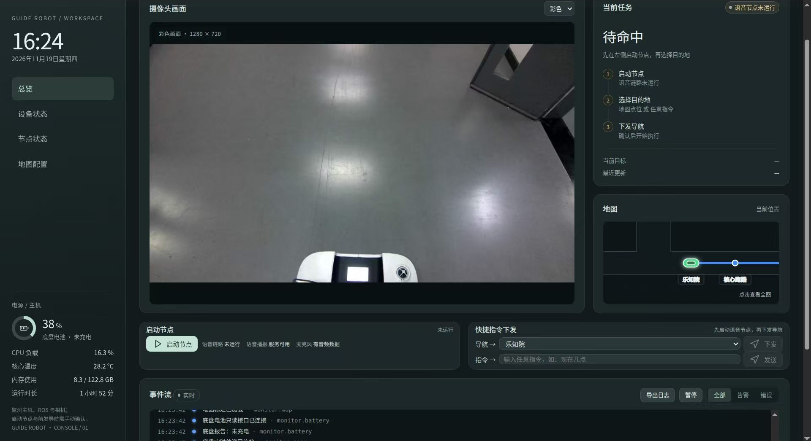
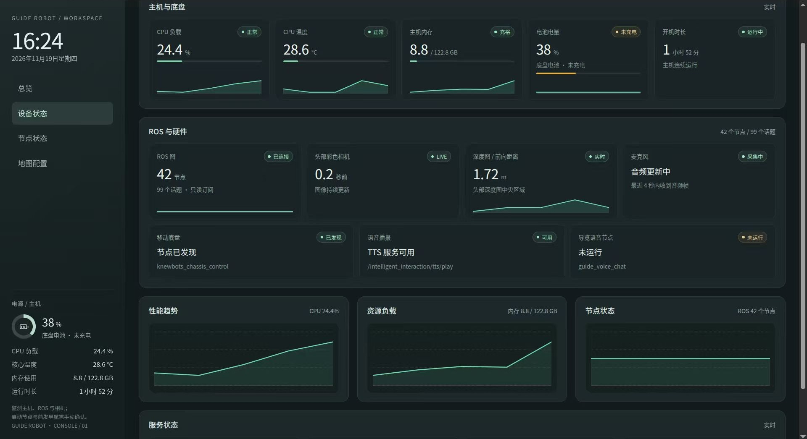
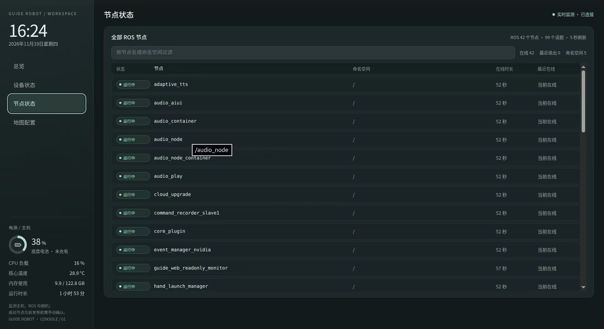
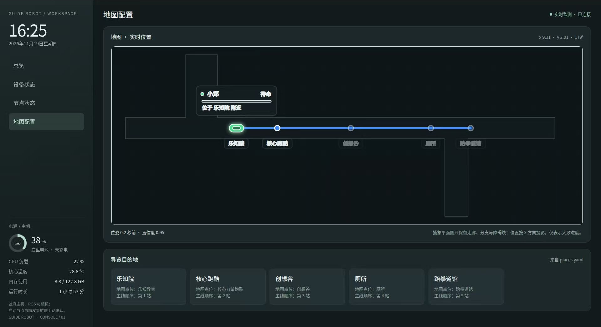
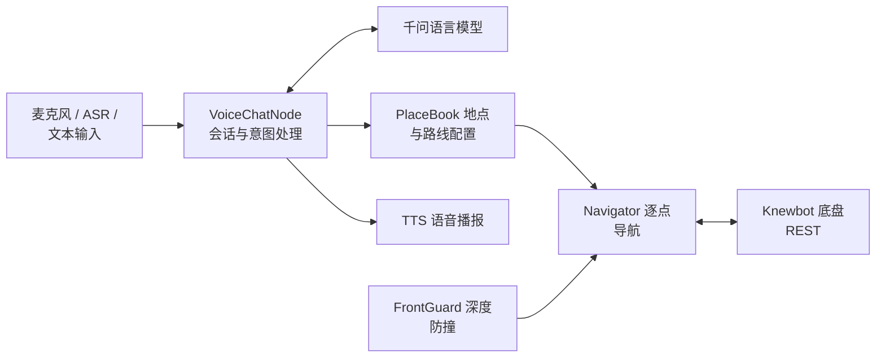

# guide_robot · 展厅语音导览机器人

基于 **ROS 2 Jazzy** 的中文语音导览项目：接收访客请求、理解目的地、逐点导航、到点播报，并在服务结束后返回待命点。项目包含一个 ROS 2 包 `guide_voice` 和独立的 Web 监测工作台。

> 本项目面向接入 Knewbot 底盘和机器人平台语音接口的实机环境。底盘 SDK、平台消息包、模型服务及地图由部署环境提供，未包含在本仓库中。

## 功能

- **三种输入**：平台 ASR、本地麦克风（VAD + faster-whisper）、ROS 文本话题。
- **地点理解**：别名匹配优先，千问补充隐式意图理解；目的地受地点白名单约束。
- **逐点带路**：按主线物理顺序往返，支持支线挂接点，避免跳过中转点。
- **到点服务**：播报到达、询问后续需求，听到“没事了”返回待命点。
- **导航保护**：底盘健康检查、定位门控、深度相机前向防撞及取消确认。
- **Web 工作台**：相机、任务、位姿、设备与 ROS 节点状态，以及需确认的控制入口。

## Web 界面预览

以下为现场工作台截图，展示总览、设备状态、节点状态和地图配置四个视图；图中数值为截图时刻的状态。

**总览**：相机画面、当前任务、地图缩略图、节点启停、快捷指令与事件流。



<details>
<summary>设备状态：主机资源、底盘电量、ROS 与硬件状态、性能趋势</summary>



</details>

<details>
<summary>节点状态：ROS 节点列表、命名空间、在线时长与过滤查询</summary>



</details>

<details>
<summary>地图配置：运行示意图、机器人位置与导览目的地</summary>



</details>

运行示意图展示沿线位置与大致进度，不等同于实际场地几何地图。启动及接口说明见 [Web 工作台文档](web_monitor/README.md)。

## 当前架构

当前使用单个 ROS 2 包 `guide_voice`，由 `VoiceChatNode` 统一编排对话与导航。



`web_monitor` 独立采集主机、ROS 与底盘状态；其导航与文本控制入口向 `/guide_voice/chat` 发布请求，由语音节点执行。点位别名、路线顺序和待命点来自 YAML，实际坐标来自底盘地图。

## 文档导航

| 文档 | 内容 |
|---|---|
| [部署与使用](docs/部署与使用.md) | 环境依赖、构建、分阶段启动、配置生效与测试 |
| [交付文档](docs/交付文档.md) | 详细架构、语音与模型实现、导航可靠性、接口及历史实车记录 |
| [Web 工作台](web_monitor/README.md) | 页面、数据来源、HTTP 接口与部署限制 |
| [GitHub 上传指南](docs/GitHub上传指南.md) | 提交范围、发布前检查、首次推送步骤 |
| [文档索引](docs/README.md) | 当前文档与历史资料的适用范围 |

## 环境与依赖

| 项目 | 要求 |
|---|---|
| 目标环境 | Ubuntu 24.04、aarch64、Python 3.12、ROS 2 Jazzy |
| 平台接口 | `interaction_msgs`、`lyre_msgs`，以及平台 TTS / ASR / 音频服务 |
| 底盘 | Knewbot REST 服务及 `robot_controller.chassis.KnewbotChassisNav` SDK |
| Python 依赖 | NumPy、PyYAML、faster-whisper；工作台另需 psutil、OpenCV |
| 模型服务 | 支持当前请求格式的 OpenAI 兼容接口，部署时指定 URL 和模型名 |
| 地图 | 底盘已完成建图、定位和 POI 配置 |

仓库中的地点配置对应原现场“消防”地图。换场地前需更新点位及语音热词。普通电脑可以运行假底盘逻辑测试，完整导览需要上述设备与服务。

## 快速开始

以下命令从**仓库根目录**开始；平台环境路径请替换为实际安装位置。完整依赖安装见[部署与使用](docs/部署与使用.md)。

```bash
source /opt/ros/jazzy/setup.bash
source /实际路径/xos/setup.bash

cd guide_ws
colcon build --packages-select guide_voice
source install/setup.bash
```

首次接入先使用文本聊天模式，关闭导航、本地麦克风与启动重定位，并指定自己的模型服务：

```bash
ros2 run guide_voice voice_chat --ros-args \
  -p enable_nav:=false \
  -p enable_mic:=false \
  -p auto_relocalize:=false \
  -p startup_goto_standby:=false \
  -p qwen_base_url:=http://127.0.0.1:8000/v1 \
  -p qwen_model:=YOUR_MODEL_NAME
```

`127.0.0.1:8000` 和 `YOUR_MODEL_NAME` 是示例，需替换为可用服务。另开已加载 ROS 环境的终端发送文本：

```bash
ros2 topic pub --once /guide_voice/chat std_msgs/msg/String "{data: '你好'}"
```

确认平台接口、地图、定位和深度图后，再按[实机启动步骤](docs/部署与使用.md#实机导航)启用导航。**默认直接启动节点会启用导航、麦克风、自动重定位和回待命点。**

## 配置地点

编辑 [`places.yaml`](guide_ws/src/guide_voice/config/places.yaml)，把地图上的 POI 名称填入别名和主线。下面是结构示例：

```yaml
standby: 接待台
aliases:
  接待台: reception
  展厅: exhibition
  卫生间: restroom
main_line:
  - reception
  - exhibition
  - restroom
branches: {}
transfer_points: []
```

- `aliases` 左侧是访客说法，右侧是底盘地图中的实际点位名。
- `main_line` 必须按物理顺序排列；坐标由底盘 POI 服务提供。
- 默认加载安装目录中的配置。普通构建后修改源码 YAML，需要**重新构建并重启节点**；也可以用 `places_file` 指定外部文件，修改后重启生效。
- 地图不存在的点位会被过滤，应检查启动日志中的可去地点与路线。

## Web 工作台

原机器人部署路径下可以直接使用：

```bash
cd web_monitor
bash start_monitor.sh --port 8765
```

浏览器访问 `http://机器人IP:8765/`。页面包含**总览、设备状态、节点状态、地图配置**四个视图。

启动脚本和后端仍包含原现场路径及底盘地址，其他机器须先按[工作台说明](web_monitor/README.md)适配。服务默认监听 `0.0.0.0`，没有登录鉴权或 HTTPS，仅适合受控局域网；请求体中的 `confirm` 标记不等于身份认证。

## 测试与验证状态

从仓库根目录执行以下命令，不需要连接实车：

```bash
python3 -m unittest discover -s guide_ws/src/guide_voice/test -v
python3 -m unittest discover -s web_monitor -p test_monitor.py -v
```

2026-11-19 文档整理时实际复跑：**导航逻辑 47 项、工作台 13 项，全部通过**。工作台测试需要 psutil 和 PyYAML。测试覆盖假底盘导航逻辑与 HTTP 边界，不代表语音、模型服务和整机联调通过。

实车测试数据保留在[交付文档第 8 章](docs/交付文档.md#8-测试与验收)，属于历史记录；本次未进行实车验证。

## 已知边界

- 当前一次处理一个目标，导航期间丢弃新的语音，不提供多目的地任务队列。
- 深度数据缺失或过期时，当前 `FrontGuard.blocked()` 返回未阻挡；实机运行前必须确认相机数据正常。
- 工作台使用固定的现场路径、底盘地址，尚未实现完整的配置化迁移。
- 仓库不包含底盘 SDK、Whisper 模型权重、机器人平台服务和建图工具。

## 发布说明

上传步骤见 [GitHub 上传指南](docs/GitHub上传指南.md)。`learn/`、`arm_demo/`、构建产物及本地备份不属于当前交付范围，已配置忽略规则。

包元数据声明 `Apache-2.0`，但仓库尚未附完整 `LICENSE`；正式开源前应确认代码与地图素材的发布权限，并补齐适用的许可证文件。第三方 SDK、模型与平台组件遵循各自许可。
