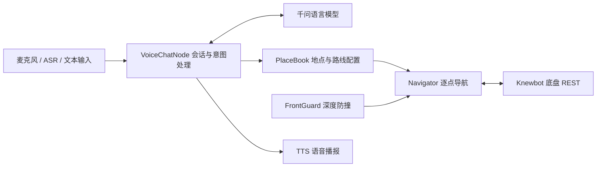

# guide_robot —— 导览机器人「小郑」

基于 ROS 2 Jazzy、Knewbot 底盘与千问语言模型的展厅语音导览项目。机器人接收语音或文本，理解访客意图，按地图点位带路，到达后播报，并可返回待命点。

## 项目状态

**已完整跑通，当前场馆各点位导航正常，语音与语言模块正常。**

截至 2026-11-17，项目负责人确认完整业务流程已实际运行通过：

- 各点位导航、主线逐点通行及往返流程正常。
- 语音识别、地点意图理解、千问对话与语音播报正常。
- 「接收请求 → 理解目的地 → 导航带路 → 到点播报 → 返回待命点」流程已跑通。

当前地图待命点为「乐知院」（地图名称「乐知教育」）。本状态依据项目负责人最新实机反馈；历史测试数据见[交付文档](docs/导览机器人交付文档.md)。

## 当前架构

当前交付使用单个 ROS 2 包 `guide_voice`，由 `VoiceChatNode` 统一编排对话与导航。



`web_monitor` 是独立的只读监测看板，不参与控制。点位别名、顺序与待命点来自 YAML，实际坐标以底盘地图为准。

## 目录

```text
guide_robot/
├── guide_ws/src/guide_voice/
│   ├── guide_voice/
│   │   ├── voice_chat_node.py    # 会话状态机、意图处理与导航编排
│   │   ├── mic_asr.py            # 麦克风采集、VAD 与 Whisper 识别
│   │   ├── qwen.py               # 千问模型客户端
│   │   ├── places.py             # 地点别名、主线与支线
│   │   ├── navigation.py         # 底盘导航、定位与异常处理
│   │   └── front_guard.py        # 深度图前向防撞
│   ├── config/places.yaml        # 场馆点位配置
│   ├── launch/voice_chat.launch.py
│   └── test/test_navigation.py
├── web_monitor/                  # 只读监测服务与网页
└── docs/导览机器人交付文档.md      # 架构、部署、接口与验证记录
```

## 构建与启动

以下命令在**机器人端**执行，部署目录为 `/home/nvidia/guide_robot`。本地文档维护目录为 `/home/vovl773/guide_robot`。

```bash
source /opt/ros/jazzy/setup.bash
source /home/nvidia/xos/setup.bash
cd /home/nvidia/guide_robot/guide_ws
colcon build --symlink-install --packages-select guide_voice
source install/setup.bash
ros2 launch guide_voice voice_chat.launch.py
```

依赖机器人已有的 `interaction_msgs`、`lyre_msgs`、语音服务与模型接口。底盘 SDK 默认从 `/home/nvidia/robot_controller/src` 加载，可通过 `ROBOT_CONTROLLER_SRC` 覆盖。

仅启用文本输入时，在已加载上述环境的终端执行：

```bash
ros2 run guide_voice voice_chat --ros-args -p enable_mic:=false
```

## 使用示例

可以直接说「带我去跆拳道馆」「回乐知院」；到达后说「没事了」返回待命点。也可通过文本话题输入：

```bash
ros2 topic pub --once /guide_voice/chat std_msgs/msg/String "{data: '带我去跆拳道馆'}"
ros2 topic pub --once /guide_voice/chat std_msgs/msg/String "{data: '回乐知院'}"
```

当前主线物理顺序：**乐知教育 → 核心力量跑酷 → 创想谷 → 厕所 → 跆拳道馆**。返程按相反顺序逐点经过。导航期间不接受新的语音目标，播报期间暂停麦克风识别，避免自身播报被再次识别。

换场馆时修改 `guide_ws/src/guide_voice/config/places.yaml` 的 `aliases`、`main_line`、`branches` 与 `standby`，并核对底盘地图点位后重新部署、验证。

## 只读监测

在机器人端另开终端：

```bash
cd /home/nvidia/guide_robot/web_monitor
bash start_monitor.sh --port 8765
```

浏览器访问机器人的 `8765` 端口。监测内容包括主机资源、ROS 节点、底盘电量、相机与日志，详见[监测说明](web_monitor/README.md)。

## 测试与交付记录

导航逻辑测试在机器人端执行，不下发真实底盘运动：

```bash
cd /home/nvidia/guide_robot/guide_ws/src/guide_voice
python3 -m unittest discover -s test -v
```

本次文档更新没有重新执行测试或实车运行。历史测试、现场参数、接口契约与功能边界见[导览机器人交付文档](docs/导览机器人交付文档.md)。
