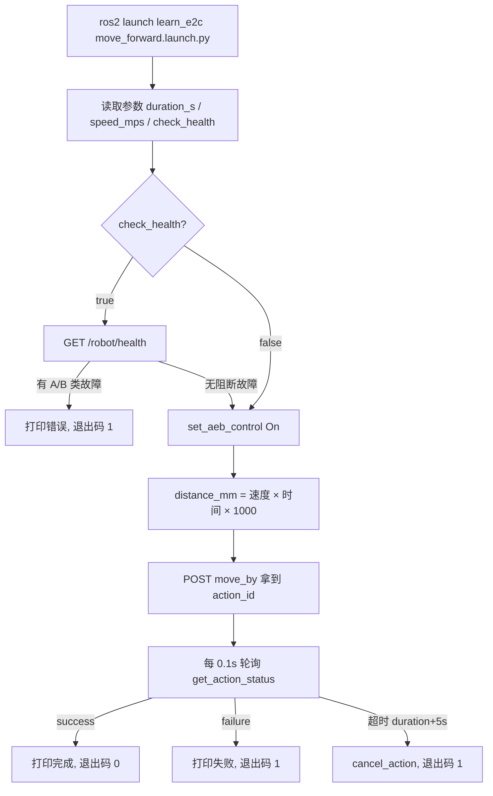

# learn_e2c 第一版：启动即前进 2 秒

> 一句话：这是一个**一次性节点**——启动后检查底盘健康、打开 AEB，下发一个"向前 0.6 米"的异步动作，然后一直等到动作结束才退出。它不是常驻节点，也不需要话题或按键。

---

## 1. 这个节点解决什么问题

底盘不是 ROS 原生接口，没有 `/cmd_vel`。它提供的是一套 HTTP REST 接口，运动方式是**异步动作**：

- 你发一个"向前走 XX 毫米"的请求 → 它只返回一个订单号 `action_id`
- 走没走完，要靠你自己轮询 `get_action_status`
- 走太久，要你自己调 `cancel_action` 取消

所以这个节点的本质是：**把一次"短距离前进"封装成一条命令，并保证它可观测、可超时、可失败退出。**

---

## 2. 当前包的文件结构

```text
learn_e2c/
├── package.xml                     # 依赖声明 + 构建类型 ament_python
├── setup.py                        # 注册 move_forward 可执行文件、安装 launch
├── setup.cfg                       # 指定脚本安装到 lib/learn_e2c
├── launch/
│   └── move_forward.launch.py      # 参数声明 + 启动节点
└── learn_e2c/
    ├── __init__.py
    ├── move_forward_node.py         # 节点本体：参数 + run + main
    └── chassis_forward.py           # 公共层：健康检查、状态轮询、超时取消
```

三者关系：`launch` 负责"传参数"，`move_forward_node` 负责"决定做什么"，`chassis_forward` 负责"怎么和底盘打交道"。

---

## 3. 执行链路



注意 AEB 设置失败只 `warn` 不退出——它是"尽力而为"的保护，不是必要条件；而健康检查失败是**直接退出**，因为那意味着运动不安全。

---

## 4. 参数

| 参数 | 默认值 | 作用 |
|---|---|---|
| `host` | `192.168.11.10` | 底盘 IP |
| `rest_port` | `9090` | REST 端口 |
| `request_timeout` | `10.0` | 单次 HTTP 请求超时 |
| `duration_s` | `2.0` | 前进时长（秒） |
| `speed_mps` | `0.3` | 限速（m/s） |
| `check_health` | `true` | 有阻断性故障时是否拒绝运动 |

`launch` 里只暴露了后三个，前三个用节点默认值。需要改的话，在 launch 的 `parameters` 里补一项即可。

---

## 5. 节点代码讲解（`move_forward_node.py`）

### 5.1 构造：只声明参数，不做事

```python
def __init__(self) -> None:
    super().__init__("move_forward")

    self.declare_parameter("host", "192.168.11.10")
    self.declare_parameter("rest_port", 9090)
    self.declare_parameter("request_timeout", 10.0)
    self.declare_parameter("duration_s", 2.0)
    self.declare_parameter("speed_mps", 0.3)
    self.declare_parameter("check_health", True)

    self._duration_s = float(self.get_parameter("duration_s").value)
    self._speed_mps = float(self.get_parameter("speed_mps").value)
    self._check_health = bool(self.get_parameter("check_health").value)

    self._chassis = KnewbotChassisNav(
        host=str(self.get_parameter("host").value),
        rest_port=int(self.get_parameter("rest_port").value),
        request_timeout=float(self.get_parameter("request_timeout").value),
    )
```

三件事：

1. **声明**参数（`declare_parameter`）——只有声明过的参数才能在命令行被覆盖；
2. **读取**参数（`get_parameter`）——注意每句都显式 `float()` / `bool()` 转换，因为参数值类型可能不严格；
3. **建客户端**——`KnewbotChassisNav` 只是保存地址，构造时不会联网。

构造函数里**没有传感器订阅、没有定时器**，这就是"一次性节点"和"常驻节点"的第一个区别。

### 5.2 `run()`：真正的业务逻辑

```python
def run(self) -> bool:
    """执行一次前进；返回是否成功。"""
    if self._check_health:
        faults = blocking_faults(self._chassis)
        if faults:
            self.get_logger().error(
                "底盘存在阻断性故障，取消前进：" + "; ".join(faults))
            return False

    try:
        self._chassis.set_aeb_control("On")
        self.get_logger().info("AEB 已开启")
    except Exception as exc:
        self.get_logger().warn(f"设置 AEB 失败（继续执行）：{exc}")

    return move_forward(
        self._chassis, self._duration_s, self._speed_mps, self.get_logger()
    )
```

顺序是有意设计的：**先判断能不能动，再开保护，最后才动**。

- 健康检查失败 → 直接 `return False`，绝不尝试"先走一点看看"；
- AEB 失败 → 只告警，因为 AEB 是降低风险，不是允许运动的先决条件；
- 返回布尔值而不是抛异常，让 `main()` 统一决定退出码。

### 5.3 `main()`：为什么不用 `rclpy.spin()`

```python
def main(args=None) -> None:
    rclpy.init(args=args)
    node = MoveForwardNode()
    try:
        ok = node.run()
    except Exception as exc:
        node.get_logger().error(f"前进异常：{exc}")
        ok = False
    finally:
        node.destroy_node()
        rclpy.shutdown()
    if not ok:
        raise SystemExit(1)
```

`spin()` 是死循环，专供常驻节点。这里做完就该退出，所以用"顺序执行 + 收尾"的结构：

- `try/except`：把异常转成一条人能看懂的错误，而不是一屏堆栈；
- `finally`：无论成功失败都释放节点、关闭 rclpy；
- `SystemExit(1)`：让 launch 和 shell 能拿到**非零退出码**，脚本化调用时才能判断成败。

---

## 6. 公共层讲解（`chassis_forward.py`）

### 6.1 时间怎么变成距离

底盘只认"走多远"，不认"走多久"：

```python
distance_mm = int(round(speed_mps * duration_s * 1000.0))
distance_mm = max(50, min(5000, distance_mm))
```

所以 `2.0 s × 0.3 m/s = 600 mm`。夹取范围 `[50, 5000] mm` 是接口约束，参数超出会被截断而不是报错。

> 重要：`v` 是**限速上限**，不是定速巡航。加上加减速和 AEB 降速，实际耗时可能略大于 2 秒，"2 秒"是近似值而不是精确控制。

### 6.2 下发与轮询

```python
response = chassis.move_by(
    direction=0.0, distance=distance_mm, move_mode=0, v=speed_mps
)
action_id = str(response.get("action_id"))

deadline = started_at + max(duration_s, 1.0) + _TIMEOUT_MARGIN_S
while time.monotonic() < deadline:
    status = chassis.get_action_status(action_id)
    state = classify_action_status(status)
    if state != "running":
        ...
        return state == "success"
    time.sleep(_POLL_INTERVAL_S)
```

- `direction=0.0` 表示沿车头正方向；
- `move_mode=0` 表示按距离；
- `_POLL_INTERVAL_S = 0.1`，即 10 Hz 查询；
- `_TIMEOUT_MARGIN_S = 5.0`，在理论时长基础上多给 5 秒缓冲。

### 6.3 状态为什么用"集合"判断

```python
_TERMINAL_SUCCESS = {"successed", "succeeded", "success", "finished", "done", "completed"}
_TERMINAL_FAIL = {"failed", "failure", "error", "cancelled", "canceled", "stopped", "aborted", "rejected"}
```

固件版本的措辞会变（`successed` 这种拼写就真实存在）。用集合做白名单，识别不了的一律归为 `running`：**宁可多等，也不误判成功**。

### 6.4 故障分级

```python
def _is_blocking_dtc(entry) -> bool:
    severity = str(getattr(entry, "severity", "") or "").strip().upper()
    if not severity:
        return True
    return any(tag in severity for tag in ("FATAL", "ERROR", "A类", "B类"))
```

- A/B 类 → 阻断运动
- C 类（如 WiFi 未连接）→ 放行
- **`severity` 读不到 → 按阻断处理**（fail-safe）

### 6.5 超时取消

```python
logger.error(f"前进超时（>{deadline - started_at:.1f}s），取消动作 {action_id}")
try:
    chassis.cancel_action([action_id])
except Exception as exc:
    logger.error(f"取消动作失败：{exc}")
return False
```

没有这段，动作一旦卡住，节点会一直等；任务跑飞时也没人喊停。

---

## 7. launch 文件的一个坑

```python
"duration_s": ParameterValue(
    LaunchConfiguration("duration_s"), value_type=float),
"check_health": ParameterValue(
    LaunchConfiguration("check_health"), value_type=bool),
```

`LaunchConfiguration` 取到的**永远是字符串**。如果不做类型转换：

- `duration_s` 可能被当成字符串塞进参数；
- 更危险的是 `check_health`，字符串 `"false"` 在 `bool()` 下是 **True**（非空字符串都为真），健康检查会静默失效。

`ParameterValue(value_type=...)` 就是在 launch 层完成这次显式转换。

---

## 8. 怎么运行

```bash
unset LD_LIBRARY_PATH          # 仅 Trae 终端需要，避免 libstdc++ 冲突
source /opt/ros/jazzy/setup.bash
source /home/nvidia/guide_robot/learn_e2c/install/setup.bash

colcon build --packages-select learn_e2c     # 改过代码才需要

ros2 launch learn_e2c move_forward.launch.py \
  duration_s:=2.0 speed_mps:=0.1 check_health:=false
echo "exit=$?"
```

预期输出：

```text
[INFO] [move_forward]: AEB 已开启
[INFO] [move_forward]: 前进 2.00s：distance=200mm，限速 0.10 m/s（约 0.20m）
[INFO] [move_forward]: 已下发 move_by，action_id=<uuid>
[INFO] [move_forward]: 前进完成，用时 x.xxs
exit=0
```

本机实测：底盘存在一条 B 类故障 `0x03020003 定位置信度低`，因此 `check_health:=false` 是这台车当前能动的**必要参数**；`check_health` 保持默认 `true` 时，节点会打印"底盘存在阻断性故障，取消前进"并以退出码 1 退出（这是预期行为，不是 bug）。

---

## 9. 常见问题

| 现象 | 原因 | 处理 |
|---|---|---|
| `GLIBCXX_3.4.29 not found` | Trae 终端注入了 `LD_LIBRARY_PATH` | 先 `unset LD_LIBRARY_PATH` 再 source |
| `command not found: ros2` | 没 source | 重新 source `/opt/ros/jazzy/setup.bash` |
| 启动即报阻断性故障 | 底盘有 A/B 类 DTC | 先修故障；测试可临时 `check_health:=false` |
| 一直不返回、最后超时 | 动作状态字段未被识别，或底盘执行异常 | 看日志里的 `status=` 原文，再决定是否补状态词 |
| 车走了但比 2 秒久 | `v` 是限速不是定速 | 正常现象，需要精确位移请用闭环方案 |
| 中途 Ctrl-C | 不会中止已在执行的动作 | 等超时自动取消，或用遥控器急停 |

---

## 10. 设计上的取舍

**为什么不用 `rclpy.spin_once` 循环等结果？**
因为这里等的是 HTTP 异步任务，不是 ROS 回调。用 `time.sleep` 轮询最简单、行为最可预测。

**为什么把公共逻辑放到 `chassis_forward.py`？**
节点的职责是"参数 + 流程编排"，底盘协议细节集中在一处，将来加"后退""转向"时不必复制粘贴。

**已知局限**

- 时间→距离是开环换算，没有里程计反馈；
- 超时取消后不检查底盘是否真的停下；
- 只支持"沿车头正方向"。

这些都适合作为后续练习：加 `move_to`、加里程计闭环、加"左转/右转"参数。

---

## 11. 验证状态

- ✅ 已确认：`colcon build --packages-select learn_e2c` 构建通过，`ros2 pkg executables learn_e2c` 只有 `move_forward`
- ✅ 已确认：底盘健康接口可访问，返回 3 条 DTC（含 B 类 `0x03020003`）
- ✅ 已确认：`check_health:=true` 时会拦截并退出 1（实际运行验证）
- ❌ 未运行验证：本文档未实际执行"车体真实前进"这一步，运动效果请现场确认
